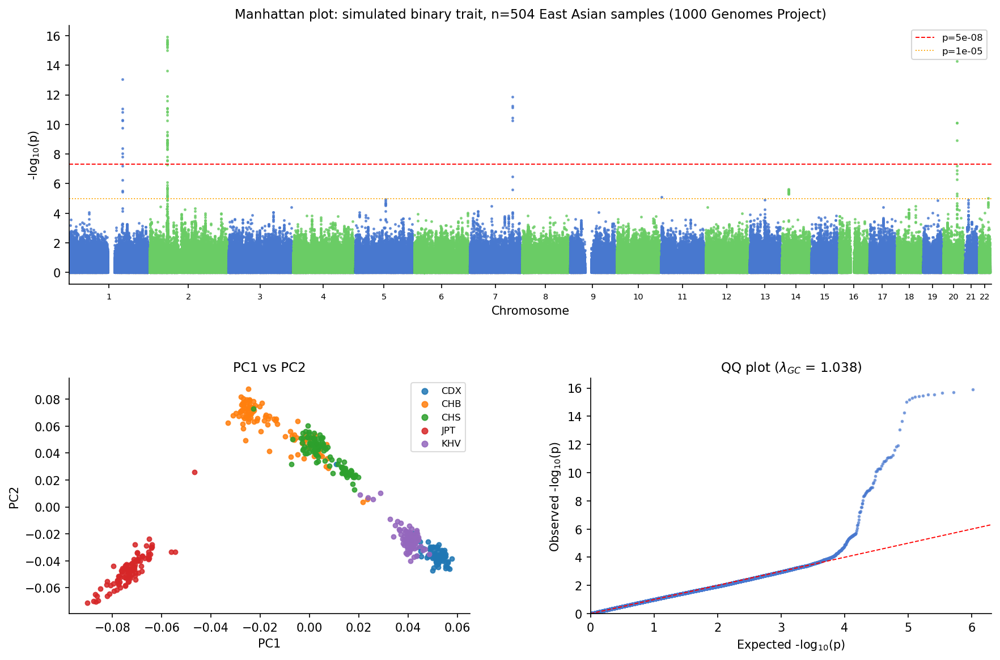

# statgen-mcp

[](https://github.com/yuan557/statgen-mcp/actions/workflows/tests.yml)
[](https://github.com/yuan557/statgen-mcp/actions/workflows/integration.yml)
[](LICENSE)

Run a GWAS pipeline by describing it in plain English. statgen-mcp exposes PLINK2 and bcftools to an AI agent, so instead of writing a Snakefile you just say what you want:

```
> QC the imputed VCF, remove related samples, run PCA, then run GWAS on BMI adjusting for age, sex, and PCs.
```

The agent chains `data_qc → king_cutoff → filter_samples → run_pca → run_gwas`, reads the intermediate outputs, picks the number of PCs from the eigenvalue curve, and flags anything odd in the QC logs. You supervise; it does the button-pushing.



*504 East Asian samples (1000 Genomes), 1.23M variants, simulated binary trait with 5 planted causal SNPs. λ_GC = 1.038, 4/5 causal SNPs recovered - the 5th had MAF 0.2% and was filtered as intended.*

## Why

GWAS QC is a long chain of PLINK commands where the right parameter at each step depends on what the last step produced. That is exactly the kind of judgement an agent can handle if you give it the tools and let it read the logs. statgen-mcp is those tools: ten thin, well-described wrappers around PLINK2 and bcftools, plus plotting. The intelligence stays in the agent; the tools just execute and report structured results back.

It covers the full path from raw genotypes or imputed VCF to a Manhattan plot: merging, variant and sample QC, relatedness and heterozygosity filtering, ancestry subsetting, PCA, association testing with Firth fallback, and QC plots. Works with PLINK1, PLINK2, and VCF input, locally or on a SLURM cluster.

## Quick start

```bash
conda create -n statgen-mcp -c bioconda -c conda-forge plink2 bcftools python>=3.11
conda activate statgen-mcp
pip install -e ".[plots]"
```

Point your agent at it with a `.mcp.json` in your project root:

```json
{
  "mcpServers": {
    "statgen-mcp": { "command": "statgen-mcp" }
  }
}
```

Then run `claude` (or any MCP-compatible agent) and describe the analysis.

**Full setup, tool reference, pipeline guide, and HPC/SLURM instructions: [docs/guide.md](docs/guide.md).**

## Roadmap

- `run_gwas_regenie` - whole genome regression for large or imbalanced cohorts
- `sanity_check` - sex concordance across phenotype, `.fam`, and chrX
- `plot_kinship` - kinship histogram and IBS0 vs kinship scatter
- PRS, fine-mapping, heritability (LDSC / GCTA)
- Self-hosted open-source LLM backend - GPU (vLLM) in progress; CPU (llama.cpp) shelved, needs >8 GB RAM and a model larger than Qwen3-1.7B. See [docs/guide.md](docs/guide.md#self-hosted-llm-backend-experimental).
- AWS Batch executor

## Acknowledgements

Pipeline validation uses the 1000 Genomes EAS dataset from [GWASTutorial](https://github.com/Cloufield/GWASTutorial) by Cloufield et al.

## Compliance note

You are responsible for ensuring your use complies with applicable regulations (HIPAA, GDPR, institutional data agreements).
